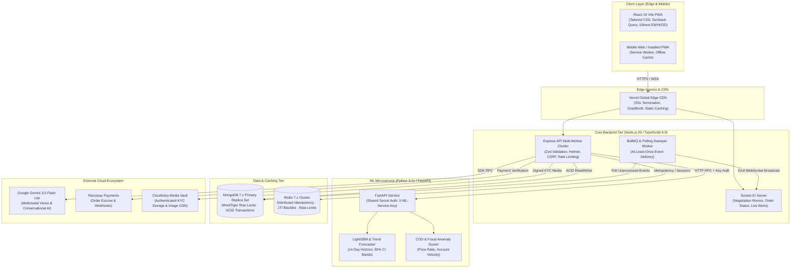

# 🏛️ FarmDirect: Enterprise System Architecture Specification

[](file:///c:/Users/nayak/OneDrive/Desktop/Projects/web/FaRm/docs/SYSTEM_ARCHITECTURE.md)
[](https://www.typescriptlang.org/)
[](https://fastapi.tiangolo.com/)
[](https://react.dev/)
[](https://www.mongodb.com/)

---

## 📑 Table of Contents
1. [Executive Architectural Overview](#1-executive-architectural-overview)
2. [End-to-End System Topology](#2-end-to-end-system-topology)
3. [Component Breakdown](#3-component-breakdown)
   - [Frontend Client Tier (`F_1`)](#31-frontend-client-tier-f_1)
   - [Core API Ingress & Cluster (`backend-ts`)](#32-core-api-ingress--cluster-backend-ts)
   - [Machine Learning Microservice (`ml-service`)](#33-machine-learning-microservice-ml-service)
   - [Data & Cache Tier](#34-data--cache-tier)
   - [External AI & Cloud Integrations](#35-external-ai--cloud-integrations)
4. [High-Concurrency Invariants & Consistency Patterns](#4-high-concurrency-invariants--consistency-patterns)
5. [Real-Time WebSocket Architecture](#5-real-time-websocket-architecture)
6. [Security & Cryptographic Perimeter](#6-security--cryptographic-perimeter)
7. [Repository File Map](#7-repository-file-map)

---

## 1. Executive Architectural Overview

FarmDirect is an enterprise-grade agritech commerce platform designed for extreme fault-tolerance, zero-oversell inventory consistency, and multimodal rural usability.

### Core Architectural Mandates:
1. **Zero Oversell Under Peak Burst Contention**: Single-phase atomic conditional decrements in MongoDB WiredTiger inside ACID multi-document transactions ensure zero inventory deficits.
2. **Elimination of Dual-Write Failures**: State mutations and outbox events commit in the same transaction using the **Transactional Outbox Pattern**.
3. **Sub-Second Vernacular AI**: Gemini 3.5 Flash Lite powers Hindi, Odia, and English agronomic advisory with deterministic offline-cached fallbacks.
4. **Side-Channel Resistant Settlement**: Payment webhooks and API signatures use constant-time cryptographic comparisons (`crypto.timingSafeEqual`).
5. **Decoupled Microservice Isolation**: Computationally intensive LightGBM price forecasting runs in an isolated Python FastAPI runtime.

---

## 2. End-to-End System Topology



---

## 3. Component Breakdown

### 3.1 Frontend Client Tier (`F_1`)
* **Technology:** React 19.2, Vite 6, Tailwind CSS 3.4.
* **State Management:** TanStack Query (React Query) for server-state caching, React Context for session and UI states.
* **Localization:** `react-i18next` with tri-lingual dictionaries:
  - English (`en.json`)
  - Hindi (`hi.json` - हिंदी)
  - Odia (`od.json` - ଓଡ଼ିଆ)
* **PWA Capabilities:** Service worker caching, offline fallback shell, Android home-screen installation.
* **Hosting:** Vercel Edge Network (`https://farm-direct-marketplace-eta.vercel.app`).

### 3.2 Core API Ingress & Cluster (`backend-ts`)
* **Technology:** Node.js 20 LTS, TypeScript 5.9, Express 4.21.
* **Process Clustering:** Native Node.js `cluster.fork()` spanning available CPU cores for zero-downtime rolling reloads.
* **Input Validation:** Zod schemas validate every inbound JSON payload, query parameter, and route parameter.
* **Security Middleware:** `helmet`, `cors`, `cookie-parser`, `express-mongo-sanitize`, `hpp`, `compression`, custom CSRF middleware with cryptographic nonce injection.
* **Rate Limiting:**
  - Sensitive authentication endpoints: Distributed Redis rate-limiter (15 attempts / 15 min).
  - High-volume polling endpoints: In-memory token bucket to conserve cloud Redis command quotas.

### 3.3 Machine Learning Microservice (`ml-service`)
* **Technology:** Python 3.11, FastAPI 0.110, Uvicorn, LightGBM, Statsmodels, Pydantic v2.
* **Authentication:** `X-ML-Service-Key` compared in constant-time via `secrets.compare_digest`.
* **Price Forecasting:** Generates 14-day rolling price predictions with 80% confidence intervals, achieving **2.38% average MAPE** across Indian regional agricultural commodities.
* **Anomaly Detection:** Flags price dumping/gouging (> 2.5x or < 0.35x mandi median), unusual order velocity, and high cancellation COD buyers.

### 3.4 Data & Cache Tier
* **Primary Database:** MongoDB 7.x Replica Set with WiredTiger storage engine:
  - Multi-document ACID transactions (`session.withTransaction`).
  - Geospatial queries via `2dsphere` indexes on farm locations.
  - Compound indexes on status, seller, buyer, and timestamp dimensions.
* **Distributed In-Memory Store:** Redis 7.x:
  - 24-hour distributed idempotency keys (`Idempotency-Key` UUID).
  - Revoked refresh token JTI blacklist.
  - High-concurrency rate limit counters.

### 3.5 External AI & Cloud Integrations
* **Google Gemini 3.5 Flash Lite:**
  - Multimodal produce classification and quality scoring.
  - Conversational agronomy AI (`AgriBot`) with prompt guardrails and PII redaction.
* **Razorpay:** Server-to-server checkout generation, webhook payment verification with HMAC-SHA256 signatures.
* **Cloudinary:** Private signed image uploads with automatic Aadhaar/PAN masking.

---

## 4. High-Concurrency Invariants & Consistency Patterns

### 4.1 Single-Phase Atomic Stock Reservation
```typescript
// Atomically ensures available quantity >= requested quantity inside WiredTiger row lock
const crop = await CropListing.findOneAndUpdate(
  { _id: cropId, quantityAvailable: { $gte: reqQty } },
  { $inc: { quantityAvailable: -reqQty } },
  { session, new: true }
);

if (!crop) {
  throw new AppError('INSUFFICIENT_STOCK', 400);
}
```

### 4.2 The Transactional Outbox Pattern

```
┌─────────────────────────────────────────────────────────────┐
│                    MongoDB Transaction                      │
│                                                             │
│   1. Insert Order Document (Status: Pending)                │
│   2. Decrement Crop Inventory (Atomic Filter)               │
│   3. Insert OutboxEvent (ORDER_CREATED, processed: false)   │
└──────────────────────────────┬──────────────────────────────┘
                               │ Guaranteed Atomic Commit
                               ▼
┌─────────────────────────────────────────────────────────────┐
│               Background Outbox Sweeper                     │
│                                                             │
│   1. Poll for OutboxEvent where processed == false          │
│   2. Publish to Socket.IO room & Notification Services      │
│   3. Update OutboxEvent set processed = true                │
└─────────────────────────────────────────────────────────────┘
```

---

## 5. Real-Time WebSocket Architecture

Socket.IO is bound directly to the Express HTTP server with JWT cookie authentication:

| Channel / Room | Scope | Payload Description |
| :--- | :--- | :--- |
| `negotiation:<id>` | Buyer & Farmer | Real-time counter-offers, price revisions, acceptance signals |
| `user:<userId>` | Private User | Personal order status updates, delivery OTPs, payment alerts |
| `admin:alerts` | System Admins | KYC submissions, fraud anomalies, system health degradation |

---

## 6. Security & Cryptographic Perimeter

1. **Timing-Safe Equality**:
   All cryptographic signatures (Razorpay webhooks, internal ML service secrets) are evaluated with `crypto.timingSafeEqual` after length pre-checks to mitigate side-channel timing attacks.
2. **Defensive AI Pipeline**:
   - PII Scrubbing (`scrubPiiFromText`): Redacts Aadhaar, PAN, phone numbers, and payment details before transmitting text to external LLMs.
   - Deterministic Guardrails: Halts execution immediately upon detecting jailbreak tokens or off-topic prompts.
   - XML Isolation: Function call data is framed in `<marketplace_data>` tags to prevent indirect prompt injections.
3. **NoSQL & Parameter Tampering Defense**:
   Express sanitization middleware strips leading `$` and `.` characters; controllers enforce strict Mongoose `Types.ObjectId` casting.
4. **Clean SAST Status**:
   Verified by GitHub CodeQL with **0 open alerts**.

---

## 7. Repository File Map

```
FaRm/
├── F_1/                   # Frontend React 19 / Vite PWA
├── backend-ts/            # Core TypeScript Express API
├── ml-service/            # Python FastAPI ML Microservice
├── docs/                  # Architecture, API, and System Documentation
├── eval/                  # Golden evaluations for AI & Vision
├── tests/                 # Load tests (k6 concurrency)
├── docker-compose.yml     # Complete local stack orchestration
└── README.md              # Project overview & quick reference
```
